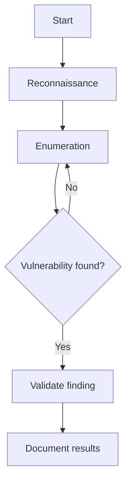
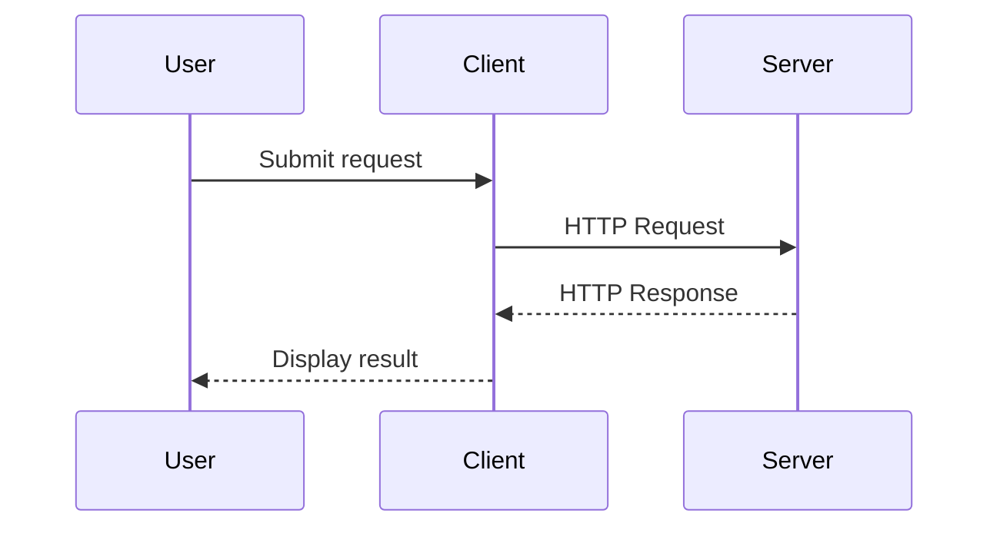

# Obsidian UI Components Showcase

> [!abstract] Purpose
> A visual reference of Markdown elements, callouts, interactive components, and formatting available in Obsidian and Quartz.

---

# 1. Callouts

## Standard callouts

> [!note] Note
> General information and documentation.

> [!info] Information
> Useful technical information or context.

> [!tip] Tip
> Helpful recommendations and shortcuts.

> [!important] Important
> Information that deserves attention.

> [!warning] Warning
> Potential problems or configuration issues.

> [!danger] Danger
> Critical warnings or security concerns.

> [!success] Success
> Successful operations or completed tasks.

> [!question] Question
> Questions that need further investigation.

> [!example] Example
> Demonstrations and practical examples.

> [!quote] Quote
> Important quotations or reference material.

## Custom callouts

> [!abstract] Overview
> Summarize the purpose of a topic.

> [!todo] To Do
> An outstanding task or objective.

> [!bug] Bug
> Document a software issue.

> [!failure] Failure
> Record an unsuccessful attempt.

> [!check] Verified
> A finding that has been confirmed.

## Collapsible callouts

> [!info]- Collapsed information
> This content is hidden until expanded.

> [!example]+ Expanded example
> This content is visible by default but can be collapsed.

## Nested callouts

> [!question] Investigation
> What caused the unexpected behavior?
>
> > [!info] Evidence
> > The application returned an unexpected response.
>
> > [!success] Resolution
> > The configuration was corrected.

---

# 2. Text Formatting

**Bold text**

*Italic text*

***Bold and italic text***

~~Strikethrough text~~

==Highlighted text==

<mark>HTML highlighted text</mark>

<sub>Subscript text</sub>

<sup>Superscript text</sup>

`Inline code`

[External link](https://www.hackthebox.com/)

[[Internal note link]]

[[Internal note link|Custom link text]]

---

# 3. Lists

## Unordered list

- First item
- Second item
  - Nested item
  - Another nested item
- Third item

## Ordered list

1. Reconnaissance
2. Enumeration
3. Exploitation
4. Privilege escalation

## Task list

- [x] Install Kali Linux
- [x] Configure HTB VPN
- [ ] Complete Academy module
- [ ] Document findings

## Nested tasks

- [ ] Cybersecurity
  - [x] Configure Kali Linux
  - [x] Configure OpenVPN
  - [ ] Complete HTB machine
  - [ ] Document findings

---

# 4. Tables

## Standard table

| Tool | Purpose | Category |
|---|---|---|
| Nmap | Network scanning | Reconnaissance |
| Gobuster | Directory enumeration | Enumeration |
| Wireshark | Packet analysis | Network |
| Burp Suite | Web testing | Application |

## Alignment

| Left aligned | Center aligned | Right aligned |
| :----------- | :------------: | ------------: |
| Linux        |    Windows     |         macOS |
| Kali         |     Server     |       Desktop |

---

# 5. Code Blocks

## Bash

```bash
nmap -sC -sV TARGET_IP
```

## Python

```python
def scan_target(ip):
    print(f"Scanning {ip}")

scan_target("10.10.10.10")
```

## PowerShell

```powershell
Get-NetTCPConnection
Get-Process
Get-Service
```

## JSON

```json
{
  "platform": "Hack The Box",
  "difficulty": "Easy",
  "status": "In Progress"
}
```

## Inline code

Use `sudo`, `nmap`, and `ip addr` to interact with the Linux environment.

---

# 6. Blockquotes

> Good documentation explains not only what happened, but why it happened.

---

# 7. Horizontal Dividers

Content above the divider.

---

Content below the divider.

---

# 8. Images and Media

## Image


## Image with custom sizing


## Embedded note

![[Example Note]]

## Embedded heading

![[Example Note#Key Concepts]]

## Embedded PDF

![[Example.pdf]]

## Audio

![[Example.mp3]]

---

# 9. Mathematical Expressions

Inline equation: $E = mc^2$

Block equation:

$$
\frac{d}{dx}f(x) = f'(x)
$$

---

# 10. Mermaid Diagrams

## Flowchart



## Sequence diagram



---

# 11. Footnotes

Documentation is important for reproducibility.[^1]

[^1]: A well-maintained knowledge base helps preserve technical knowledge.

---

# 12. HTML Components

<details>
<summary>Click to expand additional information</summary>

This is expandable HTML content.

Useful for supplementary explanations and details.

</details>

<kbd>CMD</kbd> + <kbd>P</kbd> opens the Obsidian command palette.

---

# 13. Special Characters

- Arrow: →
- Checkmark: ✓
- Cross: ✗
- Bullet: •
- Copyright: ©
- Trademark: ™

---

# 14. Documentation Footer

---

> [!quote]
> **Eddie Molina** · Cybersecurity Knowledge Base
>
> Documented for continuous learning and technical development.